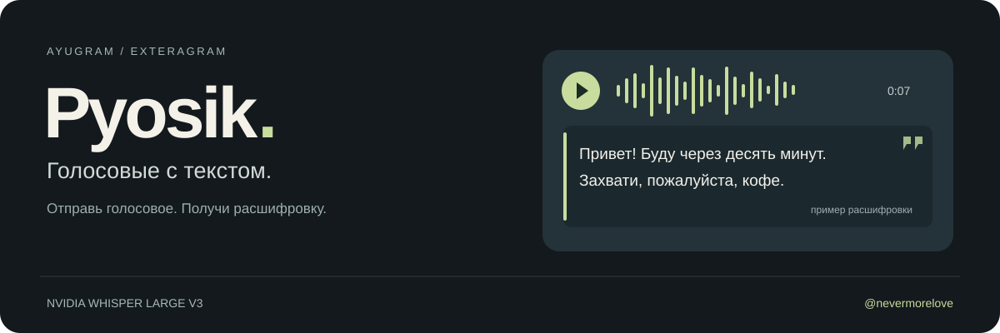

<p align="center">
  
</p>

<p align="center">
  <a href="https://plugins.exteragram.app/docs"></a>
  
  <a href="https://t.me/nevermorelove"></a>
</p>

<p align="center">
  <a href="https://github.com/ForeverInLaw/pyosik-stt/raw/refs/heads/main/pyosik.py">Скачать плагин</a> ·
  <a href="#установка">Установка</a> ·
  <a href="docs/development.md">Разработка</a> ·
  <a href="https://t.me/nevermorelove">Автор</a>
</p>

# Pyosik

Плагин для **AyuGram и exteraGram**, который автоматически расшифровывает
исходящие голосовые через NVIDIA Whisper Large v3. Текст появляется под
голосовым сообщением в виде цитаты. Собеседнику не нужен плагин, чтобы его прочитать.

Записываешь голосовое как обычно. После подтверждения отправки Pyosik
распознаёт речь и добавляет подпись к тому же сообщению.

## Что умеет

| Возможность | Как работает |
| :--- | :--- |
| Автоматическая расшифровка | Обрабатывает новые исходящие голосовые после отправки |
| Подпись цитатой | Добавляет текст к голосовому, без отдельного сообщения в чат |
| Определение языка | Режим `multi` или явный выбор языка, например `ru` и `en` |
| Несколько аккаунтов | Редактирует сообщение от имени аккаунта, который его отправил |
| Копирование текста | Сохраняет последнюю расшифровку в памяти, если подпись не поместилась |

## Установка

Нужен клиент с **Python Plugin SDK 1.4.5.0+**. Плагин проверен на AyuGram
с SDK 1.4.5.7. Для работы на телефоне достаточно файла [`pyosik.py`](pyosik.py).

Ниже приведён проверенный способ установки с компьютера через Dev Server.
На компьютере нужны Git, Python и [ADB](https://developer.android.com/tools/adb).

1. На телефоне включи движок плагинов, режим разработчика и Dev Server.
2. Склонируй репозиторий:

   ```shell
   git clone https://github.com/ForeverInLaw/pyosik-stt.git
   cd pyosik-stt
   ```

3. Подключи телефон через ADB и установи плагин:

   ```shell
   adb forward tcp:42690 tcp:42690
   python tools/dev.py install
   ```

4. Открой настройки Pyosik, введи [NVIDIA API-ключ](https://build.nvidia.com/openai/whisper-large-v3/api)
   и отправь короткое голосовое в "Избранное".

Во время первого включения SDK установит зависимости с PyPI. Dev Server
после установки можно выключить.

### Настройки

| Настройка | Значение |
| :--- | :--- |
| Расшифровывать исходящие голосовые | Включает и выключает автоматическую обработку |
| NVIDIA API-ключ | Твой ключ с доступом к Whisper Large v3 |
| Язык | `multi` по умолчанию, `ru` для русского, `en` для английского |
| Скопировать последнюю расшифровку | Копирует полный текст, в том числе после ошибки добавления подписи |

## Аудио и приватность

**Распознавание происходит в облаке NVIDIA.** Плагин передаёт туда аудиофайл
и использует твой API-ключ. Готовая подпись видна участникам чата.

Pyosik пропускает пересланные голосовые, сообщения с готовыми подписями,
секретные чаты, исчезающие и отложенные сообщения. Ключ хранится в настройках
SDK. Плагин не записывает ключ и распознанный текст в свой журнал.

## Ограничения

- Нужны интернет, действующий ключ и доступ к модели NVIDIA.
- В очереди могут находиться до четырёх голосовых. Одновременно распознаётся одно.
- Размер аудио ограничен 20 МиБ, таймаут запроса составляет 60 секунд.
- Действует лимит подписи Telegram для конкретного аккаунта. Длинный текст
  не обрезается: скопируй его в настройках Pyosik.
- Последняя расшифровка хранится в памяти до отключения или перезагрузки плагина.

## Проверено на телефоне

На Pixel 8 Pro с AyuGram и SDK 1.4.5.7 проверена вся цепочка:
отправка голосового, распознавание NVIDIA и добавление подписи в Telegram.
В тесте короткого голосового подпись добавилась за **0,9 секунды**.
Это результат одного теста, время зависит от длины записи и ответа сервиса.

Оформление цитатой подтверждено повторным чтением сообщения с сервера Telegram.

<details>
<summary>Для разработчиков</summary>

Плагин поставляется одним Python-файлом. gRPC работает через `grpclib`
и `protobuf` на чистом Python. Windows EXE и отдельный сервер не требуются.

```shell
python -m venv .venv
```

В Windows:

```powershell
.venv\Scripts\python.exe -m pip install -r requirements-dev.txt
.venv\Scripts\python.exe -m unittest discover -s tests -v
.venv\Scripts\ruff.exe check pyosik.py tools tests
```

В Linux и macOS используй `.venv/bin/python` и `.venv/bin/ruff`.

В репозитории 16 тестов на запрос распознавания, оформление цитат,
выбор аккаунта, дубли событий, очередь, отключение и обработку ошибок.
Подробности устройства плагина, Dev Server и генерации protobuf находятся
в [документации разработки](docs/development.md).

</details>

## Автор

[**@nevermorelove**](https://t.me/nevermorelove)

Документация платформы: [exteraGram Plugins](https://plugins.exteragram.app/docs).
Модель распознавания: [NVIDIA Whisper Large v3](https://build.nvidia.com/openai/whisper-large-v3/api).
